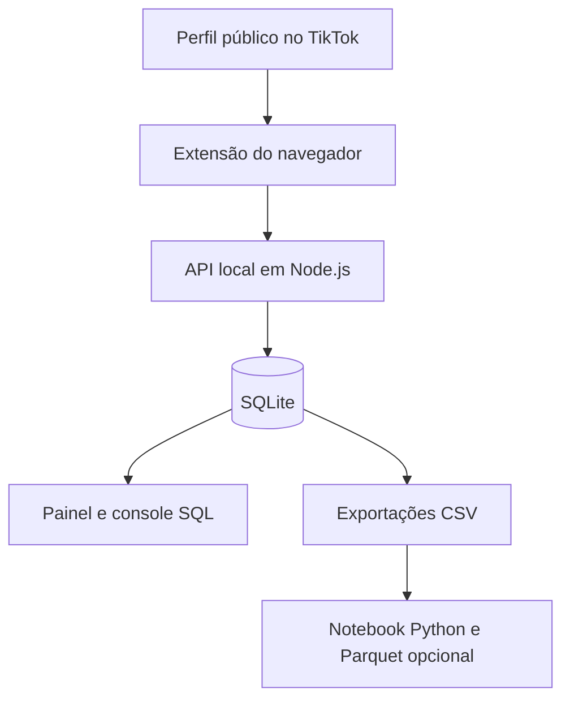

# Observatório TikTok

Aplicação local que recebe o link de um perfil do TikTok, coleta os dados públicos disponíveis no navegador e organiza um histórico em SQLite. O painel e o notebook ajudam a investigar padrões de visualizações e engajamento por canal, horário, hashtag e duração.

O fluxo principal usa uma extensão de Chrome ou Edge e dispensa chave da API oficial. A extensão observa os dados disponibilizados à aba do TikTok. Mudanças na página e restrições da plataforma podem reduzir a cobertura.

## Rodar localmente

Requer Node.js 22.13 ou superior e Chrome ou Edge com suporte a Manifest V3.

```bash
git clone https://github.com/ItaloLRC/observatorio-tiktok.git
cd observatorio-tiktok
npm start
```

1. Abra `chrome://extensions` no Chrome ou `edge://extensions` no Edge.
2. Ative **Modo do desenvolvedor**, escolha **Carregar sem compactação** e selecione a pasta `extension/`.
3. Abra o [painel local](http://127.0.0.1:8766) e confirme que a extensão está conectada.
4. Em **Coletor**, cole um link como `https://www.tiktok.com/@usuario`, escolha se deseja incluir comentários e inicie a coleta. Mantenha o painel e a aba do TikTok abertos. Se o TikTok pedir login ou verificação, conclua essa etapa na própria aba.

O banco é criado em `.local/rtr.sqlite`. Use `npm start -- --port 8767` para trocar a porta. No Windows, `INICIAR-RTR.cmd` também inicia o servidor.

## Arquitetura



| Diretório | Responsabilidade |
| --- | --- |
| [extension/](extension/) | Navegação, extração, integração com o painel e controle de ritmo |
| [server/](server/) | Servidor HTTP local, exportações e execução isolada das consultas SQL |
| [runtime/](runtime/) | Rotas da aplicação, normalização, fila de coleta, persistência e migrações |
| [web/](web/) | Painel de coleta e análise, gerenciamento de dados e console SQL |
| [analysis/](analysis/) | Carregador de snapshots, notebook exploratório e conversão para Parquet |
| [tests/](tests/) | Testes automatizados de coleta, persistência, análise, SQL e exportação |

O SQLite separa vídeos, perfis e hashtags dos snapshots de métricas. A fila registra progresso, interrupções e cobertura parcial. É possível retomar trabalhos pelo painel. Respostas HTTP 403 ou 429 observadas durante a coleta interrompem o trabalho.

## Explorar os dados

- **Visão geral.** Filtre por canal, datas, série e mínimo de visualizações. Compare horários, dias, hashtags e faixas de duração.
- **Correlações e regressão.** Explore correlações de Pearson e regressões lineares, com tamanho da amostra e indicadores do ajuste.
- **Banco e exportação.** Consulte o esquema e execute SQL em modo somente leitura. Os CSVs completos são gravados em `.local/exports/`. Use `active_video_metrics` para omitir itens na lixeira e o manifesto `latest.json` para ler tabelas de uma geração consistente.

Depois de coletar vídeos e aguardar a exportação, prepare o ambiente Python e abra o notebook.

```bash
python -m pip install -r analysis/requirements.txt
python -m jupyter lab analysis/danalysis.ipynb
```

O notebook usa uma janela de 30 dias que termina na publicação mais recente da base, com data de referência configurável. Ele salva os gráficos e tabelas em `analysis/resultados/`. Para converter os CSVs para Parquet, instale `pyarrow` e execute `python analysis/to_parquet.py`. Use `--watch` para acompanhar novas exportações.

O [estudo de caso](docs/estudo-de-caso.md) documenta uma análise exploratória de 268 vídeos de 8 canais. As associações ajudam a formular hipóteses sobre conteúdo e publicação. Veja também a [metodologia](docs/metodologia.md).

## Testes

```bash
npm test
```

Os testes executam com bancos temporários e dados de exemplo. A cobertura da coleta no navegador depende da sessão e do conteúdo que o TikTok disponibiliza no momento.
