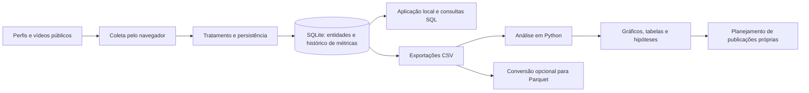

# Estudo de caso do Observatório TikTok

## Coleta, armazenamento e análise exploratória de vídeos de animação narrativa

**Tipo:** projeto pessoal de dados aplicado à criação de conteúdo.

**Estágio atual:** pipeline implementado; dez gráficos exploratórios e tabelas de apoio gerados no notebook; interpretação dos padrões em andamento e validação no canal próprio ainda pendente.

**Documentação:** 15 de novembro de 2026, atualizada após a ampliação de `analysis/danalysis.ipynb`.

## 1. Origem e problema

O projeto começou com o objetivo de criar um canal no TikTok para publicar vídeos curtos de animação narrativa. Antes de iniciar a produção, procurei canais do mesmo nicho para entender seus temas, formatos, aberturas e padrões de publicação.

A observação manual trouxe referências, mas também uma dificuldade: comparar vídeos de canais com tamanhos, frequências e históricos diferentes. Um vídeo com 100 mil visualizações pode estar abaixo do habitual de um canal grande e muito acima do habitual de um canal pequeno. Comparar apenas os números absolutos poderia levar a decisões inadequadas.

Para investigar essas diferenças de forma organizada, desenvolvi ferramentas de coleta e uma aplicação local para armazenar, consultar e visualizar os dados. O projeto passou a combinar engenharia de dados, desenvolvimento de software e análise exploratória.

A pergunta que orienta o trabalho é:

> Quais características de publicação e de conteúdo estão associadas a desempenho acima do habitual de cada canal, e quais dessas associações merecem ser testadas em um novo canal?

O objetivo inicial é reduzir a incerteza sobre o que produzir e testar. Prever viralização não é uma entrega demonstrada nesta etapa.

## 2. Solução desenvolvida

O fluxo conecta a captura dos dados à análise:

A primeira iteração usou Playwright. Nesta versão, a coleta foi integrada ao aplicativo por meio de uma extensão de navegador.

Na versão integrada, a extensão utiliza abas do navegador para obter os dados disponibilizados pela plataforma, e o serviço local os recebe e persiste. A aplicação oferece filtros, indicadores, comparações, exportação e consulta ao banco.

O banco separa entidades relativamente estáveis, como vídeos e canais, de observações das métricas em momentos de coleta. Existem registros históricos para vídeos, canais e comentários, além de tabelas para hashtags e seus relacionamentos. Cada nova coleta pode registrar uma nova observação; isso permite acompanhar mudanças quando há coletas sucessivas do mesmo vídeo. A existência da estrutura histórica, sozinha, não garante uma série temporal completa ou observações em intervalos regulares.

Também estão implementados registros de tarefas e eventos de coleta, estados de coleta parcial ou interrompida e preservação de campos ausentes. Essas informações ajudam a distinguir dados não disponíveis de valores efetivamente iguais a zero.

As exportações CSV incluem tabelas e uma visão consolidada das métricas mais recentes. Há um carregador em Python para ler uma geração consistente das exportações, preservando identificadores e valores nulos. A conversão para Parquet é opcional e depende de sua execução no ambiente Python.

**Tecnologias identificadas:** JavaScript, Node.js, extensão de navegador, SQLite, SQL, HTML/CSS, Python, pandas, NumPy e Matplotlib; PyArrow na conversão opcional para Parquet.

## 3. Dados e unidade de análise

Nas comparações de desempenho atuais, a unidade principal é o vídeo, associado ao seu canal e à observação mais recente disponível de suas métricas. Entre os campos utilizados estão identificador, canal, data e horário de publicação, duração, descrição, hashtags e contagens públicas de interações, quando disponíveis.

O histórico tem outra unidade: uma observação de um vídeo em determinada coleta. Essa distinção evita contar várias observações do mesmo vídeo como se fossem vídeos independentes.

No conjunto de resultados consultado para esta documentação, a análise recente contém **268 vídeos únicos de 8 canais**, publicados entre **17 de outubro e 14 de novembro de 2026**. O filtro do notebook considera a janela de **17 de outubro a 15 de novembro de 2026**, em `America/Sao_Paulo`. As datas de captura das métricas desse conjunto abrangem 14 e 15 de novembro no fuso de Brasília. Esses números descrevem essa versão dos resultados, e não um tamanho definitivo da base.

É importante distinguir duas datas: a publicação do vídeo e a captura de suas métricas. Selecionar vídeos publicados nos últimos 30 dias não significa medir apenas as visualizações recebidas nos últimos 30 dias. As contagens utilizadas são acumuladas até o momento da coleta.

## 4. Abordagem quantitativa

### Comparação dentro de cada canal

O primeiro passo é observar o desempenho absoluto de cada canal: número de vídeos, média, mediana e dispersão das visualizações. Para cada dia da semana, calculo a média das views dos vídeos publicados naquele dia:

\[
\overline{V}_{c,d}=\frac{\sum_{i\in(c,d)}V_i}{n_{c,d}}
\]

O denominador considera vídeos com views disponíveis. Isso mede views acumuladas médias por vídeo publicado naquele dia da semana; não mede as views recebidas pelo canal naquele dia do calendário.

### Padronização por canal

Para reunir canais de escalas diferentes, o notebook calcula o z-score de cada vídeo em relação ao próprio canal, após aplicar o filtro de período:

\[
z_{i,c}=\frac{V_{i,c}-\mu_c}{\sigma_c}
\]

Nesta implementação, o desvio padrão usa `ddof=0`. Valores positivos representam vídeos acima da média do canal na janela analisada; negativos, abaixo. Um escore de 0,8 representa 0,8 desvio padrão acima dessa média, e não 80% mais views. Quando o desvio é zero ou a métrica não está disponível, o escore fica ausente.

Os valores originais são preservados. A padronização facilita a comparação, mas continua sensível a vídeos extremos e não elimina diferenças de conteúdo, público ou idade dos vídeos. Ela também não transforma a distribuição em normal.

### Dias da semana e faixas de horário

Depois da padronização, reúno os vídeos e calculo a média e a mediana dos escores por dia da semana e por faixas de duas horas, como 10h–12h e 18h–20h. As faixas incluem o início e excluem o limite final: 11h30 pertence a 10h–12h, enquanto 12h pertence à próxima faixa.

As tabelas incluem a quantidade de vídeos e de canais. A agregação atual dá o mesmo peso a cada vídeo com escore disponível; canais com mais publicações podem contribuir mais. Uma análise complementar poderá calcular primeiro o resultado por canal e grupo, para depois reunir os canais com peso igual.

As primeiras observações motivaram horários candidatos para teste. Esses candidatos permanecem hipóteses: rankings podem mudar conforme o período, a composição da amostra, a largura das faixas e o uso de média ou mediana.

Um exemplo dessa sensibilidade aparece nos resultados recentes: a faixa 14h–16h tem média de z-score de aproximadamente **+0,226**, com **28 vídeos de 6 canais**, mas mediana de aproximadamente **−0,397**. A média positiva não significa que o vídeo típico desse grupo esteja acima da média de seu canal. É um motivo para examinar a distribuição e os vídeos que influenciam o resumo, antes de escolher um horário.

### Hashtags

Para cada tag, calculo a média e a mediana das views originais e dos escores padronizados, acompanhadas da quantidade de vídeos e canais. Cada par vídeo–tag aparece uma única vez. Um vídeo com várias tags participa de vários grupos, portanto os resultados desses grupos não são independentes.

A pergunta atual é quais tags aparecem em vídeos com desempenho relativo mais alto. Outra pergunta, ainda a acrescentar explicitamente, é a proporção de vídeos acima da mediana do respectivo canal entre os que usam cada tag. São indicadores diferentes: um z-score positivo indica desempenho acima da média, não necessariamente acima da mediana.

Uma tag bem colocada em um ranking com apenas um vídeo oferece pouca evidência de repetição. Por isso, acrescentei uma seleção com pelo menos **10 vídeos com z-score disponível e presença em 2 canais**. A tabela salva contém todas as tags elegíveis; o gráfico exibe até 15 com maior média de z-score, mostrando também a mediana. Na versão consultada, 25 tags atendem ao filtro. Esse critério reduz resultados apoiados em casos isolados, mas não estabelece significância estatística nem separa o efeito das tags que aparecem juntas. Também é necessário distinguir o tema representado pela tag de um eventual efeito da própria hashtag sobre a distribuição do vídeo.

### Frequência de publicação

O notebook registra dias com publicação, quantidade de vídeos e regularidade em janelas móveis de sete dias ao longo da janela de 30 dias. Cada dia vale no máximo uma presença, mesmo quando há vários vídeos. A janela de 30 dias gera 24 janelas completas de sete dias.

O calendário visual de publicações complementa as contagens: cada célula representa o número de vídeos encontrados para um canal em uma data. Ele permite observar pausas e concentração de postagens, considerando que zero significa ausência observada na base e pode refletir cobertura incompleta.

Essa análise descreve **regularidade de publicação**. A hipótese seguinte é verificar se canais que publicam em mais dias apresentam **desempenho por vídeo mais estável**. O cruzamento entre essas duas dimensões ainda não está demonstrado nos resultados consultados.

Para avaliá-lo, será necessário definir estabilidade de desempenho e comparar medidas de dispersão em contextos equivalentes. Desvio padrão absoluto depende da escala do canal. Proximidade entre média e mediana, isoladamente, não demonstra baixa variabilidade: uma distribuição simétrica pode ter as duas iguais e, ainda assim, apresentar grande dispersão. As 24 janelas móveis também se sobrepõem e não devem ser tratadas como 24 amostras independentes.

### Distribuição, engajamento, duração e concentração

A exploração foi ampliada para examinar aspectos que uma média isolada não revela:

- **Distribuição por canal:** boxplots e pontos individuais mostram mediana, quartis e dispersão das views originais. O eixo logarítmico facilita visualizar canais de escalas diferentes; não é a padronização por z-score.
- **Dia × horário:** um mapa cruza dia da semana e faixa de duas horas, mostrando a média de z-score e o número de vídeos por combinação. Só recebem cor células com pelo menos 3 vídeos. Esse é um critério de exibição, não uma garantia de confiabilidade; a tabela registra também quantos canais contribuem.
- **Engajamento por mil views:** calculo, para cada vídeo, curtidas, comentários, compartilhamentos e salvamentos divididos pelas views positivas e multiplicados por 1.000. Depois calculo a mediana por canal. Essa medida não equivale à razão entre os totais do canal. Cada coluna do gráfico tem sua própria escala de cor, e campos ausentes não são convertidos em zero. As razões descrevem interações por exposição, sem demonstrar que elas causaram mais views.
- **Duração e desempenho:** comparo os z-scores entre as faixas abaixo de 60 segundos, 60–89, 90–119, 120–149 e 150 segundos ou mais. Pontos mostram vídeos, caixas mostram quartis e mediana, e losangos representam a média. O gráfico investiga associação com views, sem medir retenção ou isolar duração de tema e canal.
- **Concentração de views:** ordeno os vídeos de cada canal do mais visto ao menos visto e acumulo sua participação nas views. Também calculo a parcela concentrada no grupo de aproximadamente 10% mais vistos, arredondando **0,10 × N** para cima. Em canais pequenos, esse arredondamento faz o grupo representar mais de 10% dos vídeos; a quantidade efetiva aparece na legenda e na tabela.

Essas visualizações já foram produzidas. A interpretação conjunta, a escolha dos padrões a testar e a avaliação da sensibilidade a valores extremos seguem em andamento.

## 5. Gráficos produzidos e perguntas de leitura

O notebook possui saídas executadas e dez arquivos PNG na pasta **analysis/resultados**, além das tabelas CSV correspondentes quando há agregações. Os links abaixo são relativos à raiz do projeto.

| Gráfico | Pergunta que orienta a leitura | Arquivo |
|---|---|---|
| Média de views por dia, separada por canal | O padrão semanal muda entre canais? | 01 — Views por canal e dia |
| Média de z-score por dia da semana | Quais dias ficaram acima ou abaixo da média dos respectivos canais? | 02 — Desempenho por dia |
| Média de z-score por faixa de duas horas | Quais faixas merecem investigação, considerando quantidade de vídeos e canais? | 03 — Desempenho por horário |
| Distribuição de views por canal | Como o vídeo típico e a dispersão se diferenciam entre canais? | 04 — Distribuições |
| Mapa de dia × horário | Uma média geral esconde diferenças entre combinações de dia e horário? | 05 — Dia e horário |
| Mediana de interações por mil views | Quais tipos de interação são mais presentes no vídeo típico de cada canal? | 06 — Engajamento |
| Duração × desempenho relativo | As faixas de duração têm distribuições de desempenho diferentes? | 07 — Duração |
| Concentração acumulada de views | Quanto do total depende dos vídeos mais vistos? | 08 — Concentração |
| Calendário de publicações | Há constância, pausas ou concentração de posts em poucas datas? | 09 — Calendário |
| Tags com amostra mínima | A média elevada de uma tag acompanha uma mediana elevada e presença em vários canais? | 10 — Tags |

### Exemplos descritivos para orientar a revisão

Os resultados abaixo registram o que as tabelas mostram nesta versão. São pontos de partida para minha leitura dos gráficos, sem definir recomendações finais de conteúdo ou publicação:

- **Concentração:** em um canal com 12 vídeos, os 2 mais vistos reúnem aproximadamente **95,4%** das views do recorte. Nesse caso, o grupo arredondado corresponde a 16,7% dos vídeos. Isso ajuda a entender por que a média pode representar mal o desempenho habitual desse canal.
- **Duração:** a faixa abaixo de 60 segundos contém apenas **6 vídeos de 2 canais**, enquanto 90–119 segundos reúne **100 vídeos de 8 canais**. A diferença de composição precisa ser considerada antes de atribuir os resultados à duração. Na tabela atual, todas as faixas têm mediana de z-score negativa, mesmo quando a média é positiva.
- **Tags:** a hashtag **#nessemundo** aparece em **60 vídeos de 4 canais**, com média de z-score de aproximadamente **+0,362** e mediana de **−0,133**. Isso permite investigar a diferença entre o resultado médio e o típico desse grupo; não demonstra que a hashtag aumenta alcance. A presença da hashtag também não comprova que a expressão foi usada na abertura falada do vídeo.

No gráfico de tags, o segmento entre média e mediana indica apenas a distância entre essas medidas; **não é um intervalo de confiança**. No mapa de dia × horário, a cor representa a média das observações daquela célula, não um efeito causal estimado.

### Registro da interpretação

Para cada gráfico, a próxima etapa é registrar a observação, os vídeos e canais que a sustentam, explicações alternativas, verificações adicionais e o teste que ela sugere. Dessa forma, o estudo distingue quatro estágios: **saída gerada, padrão observado, hipótese formulada e hipótese avaliada em novas publicações**. Nesta atualização, as saídas estão geradas e a interpretação dos padrões segue em andamento.

## 6. Leitura qualitativa dos vídeos

Além das métricas, comecei a examinar a estrutura narrativa dos conteúdos. Nas observações manuais, identifiquei aberturas recorrentes como “Nesse mundo” e “Nesse lugar”, além de vídeos que começam com uma cena de impacto, clímax ou situação ambígua antes de desenvolver a história.

Minha hipótese é que esses recursos apresentam rapidamente uma situação interessante e criam curiosidade sobre sua explicação ou desfecho. Essa é uma interpretação qualitativa inicial, ainda sem uma classificação sistemática de todos os vídeos.

Para transformá-la em análise estruturada, posso registrar variáveis como:

- Tipo de abertura: contextualização, pergunta, conflito, clímax ou demonstração.
- Presença de uma situação ambígua nos primeiros segundos.
- Tempo até apresentar o conflito central e até entregar a primeira informação relevante.
- Uso de texto na tela, narração e mudanças de cena.
- Duração e momento do desfecho.

Os dados públicos utilizados não medem retenção aos 3 segundos, aos 30 segundos ou até o final. Assim, a formulação correta nesta etapa é **identificar recursos narrativos que podem favorecer retenção**, e não afirmar que a retenção foi medida ou que determinada abertura a aumentou.

Com dados internos do meu canal, poderei avaliar essas hipóteses pelas métricas efetivamente disponíveis. Comparações aos 30 segundos exigirão vídeos com duração suficiente e atenção às diferenças de duração entre formatos.

## 7. Histórico disponível versus últimos 30 dias

Uma direção importante do projeto é verificar se os padrões se mantêm no histórico disponível de cada canal e no período recente. Isso ajuda a investigar mudanças de formato, público, ritmo de publicação e desempenho.

O notebook consultado concentra suas análises na janela recente. A comparação sistemática entre histórico disponível e últimos 30 dias permanece como extensão do estudo.

Nessa comparação, pretendo preservar tanto as views originais quanto os indicadores relativos. Se cada janela for padronizada separadamente, a média de z-score de cada canal será zero em ambas por construção; comparar apenas essas médias não revela crescimento absoluto. Para avaliar mudança de nível, precisarei comparar métricas originais ou utilizar uma referência fixa, claramente definida.

Também usarei a expressão **histórico disponível**, pois cobertura incompleta da coleta não equivale a todo o histórico real do canal. Um dia sem vídeo encontrado só pode ser interpretado como ausência de publicação quando houver cobertura suficiente para essa conclusão.

## 8. O que foi entregue e o que ainda é hipótese

| Frente | Situação documentada |
|---|---|
| Coleta e armazenamento local | Implementados; cobertura depende do conteúdo disponibilizado e das coletas realizadas |
| Histórico de métricas | Estrutura implementada para observações em coletas sucessivas |
| Aplicação, SQL e exportação CSV | Implementados |
| Conversão para Parquet | Implementação opcional disponível |
| Comparações recentes por canal, dia, horário e tag | Implementadas no notebook, com resultados salvos |
| Regularidade de publicação em 30 dias e calendário | Calculados e visualizados |
| Distribuição de views, engajamento e duração × desempenho | Gráficos e tabelas gerados; interpretação em andamento |
| Cruzamento dia × horário | Mapa gerado, com contagens e filtro visual de amostra |
| Concentração das views nos vídeos mais vistos | Calculada e visualizada por canal |
| Tags com pelo menos 10 vídeos e 2 canais | Tabela e gráfico produzidos |
| Regularidade associada a estabilidade de views | Hipótese a investigar |
| Padrões de abertura e narrativa | Observações qualitativas iniciais |
| Retenção aos 3 segundos, 30 segundos e final | Não medida pelos dados públicos atuais |
| Histórico disponível versus período recente | Comparação sistemática a desenvolver |
| Testes no canal próprio | Ainda não realizados nesta etapa |

A aplicação também contém recursos de correlação e regressão descritiva. A presença dessas ferramentas não equivale a um modelo preditivo validado. Não há resultado demonstrado de previsão de viralização ou de melhora de alcance causada pelas decisões propostas.

## 9. Limitações e próximos passos

As associações observadas estão sujeitas à seleção dos canais, cobertura de coleta, diferença de idade dos vídeos, concentração de temas em determinados horários e influência de vídeos extremos. Procurar muitos padrões também aumenta a possibilidade de encontrar diferenças ocasionais.

A etapa imediata é revisar os dez gráficos e suas tabelas, registrar as hipóteses mais sustentadas e examinar se poucos vídeos ou canais explicam os resultados. Os critérios de 3 vídeos por célula e de 10 vídeos em 2 canais para tags organizam a exibição; não substituem uma avaliação de incerteza.

O próximo ciclo será publicar no meu canal, com 11h30 e 18h como candidatos iniciais sujeitos à revisão, e acompanhar os resultados após prazos comparáveis. Pretendo distribuir temas e formatos entre os horários, registrar alterações e evitar conclusões baseadas em um único vídeo. As primeiras semanas constituirão um piloto, não um teste com poder estatístico previamente estabelecido.

Em paralelo, posso acompanhar novos vídeos dos canais de referência com coletas sucessivas. Isso permite estudar se métricas iniciais acrescentam informação para prever crescimento posterior, distinguindo previsão de causalidade.

Para tornar a análise mais fácil de reproduzir e compartilhar, os próximos ajustes de documentação são registrar a versão dos dados utilizada, dependências do ambiente, critérios de seleção e instruções para gerar os resultados. O carregador já disponível pode ser utilizado no notebook para vincular explicitamente a leitura a uma geração das exportações.

## 10. Contribuição do projeto para o portfólio

Este projeto demonstra a construção de uma solução de dados a partir de uma necessidade própria: formular uma pergunta, obter informações, organizar entidades e histórico, disponibilizar consultas e analisar padrões para orientar decisões.

Sua contribuição atual está na integração entre engenharia de dados e análise exploratória, agora com dez visualizações que abordam desempenho, dispersão, engajamento, concentração e comportamento de publicação. A etapa de experimentação no canal próprio acrescentará evidência sobre a utilidade das hipóteses, mas não é condição para documentar o trabalho já realizado. Estudos observacionais de outros canais também são uma forma válida de análise, desde que o alcance das conclusões seja explícito.

Uma apresentação resumida do trabalho é:

> Desenvolvi um observatório local de conteúdo no TikTok, com coleta pelo navegador, armazenamento relacional e histórico de métricas, aplicação de visualização e exportação para análise em Python. Produzi análises e visualizações de desempenho por dia, horário, hashtag e duração, além de distribuições de views, taxas de interação, concentração de views e calendário de publicações. Utilizei padronização por canal para comparar perfis de escalas diferentes. O estudo gera hipóteses de conteúdo e publicação para avaliação posterior em um canal próprio.

## Referência da documentação

Este texto foi preparado a partir da descrição do projeto e da leitura dos arquivos locais, incluindo `README.md`, `runtime/schema.sql`, `runtime/repository.mjs`, os módulos de exportação, `analysis/rtr_data.py`, `analysis/to_parquet.py`, `analysis/danalysis.ipynb` e seus resultados, e do protótipo anterior de coleta.

As observações sobre expressões de abertura e estrutura narrativa foram relatadas pelo autor do projeto; não representam uma revisão independente de todos os vídeos. Esta atualização utiliza a versão do notebook salva em 15/11/2026 às 17h34, com 17 células de código executadas e sem saídas de erro registradas, dez gráficos PNG e tabelas CSV. As imagens foram inspecionadas junto dos cálculos que as geram. A conferência dos resultados salvos identificou 268 vídeos únicos, 8 canais, totais por dia e horário compatíveis com esse conjunto e médias de z-score por canal próximas de zero. Não foi executada uma nova coleta, uma nova execução integral do notebook nem uma auditoria completa do software para produzir este documento.
